# Cloud Detection & Automated Response — AWS

An AWS environment that watches itself and fights back. GuardDuty detects
threats from CloudTrail, VPC Flow Logs and DNS activity; EventBridge routes
each finding to a purpose-built Lambda responder; the responder contains the
threat — isolating a compromised server, disabling a leaked access key, or
re-locking an exposed bucket — and emails a report of exactly what it did.
No human in the loop between detection and containment.

Everything is Terraform. Built as a portfolio project to demonstrate cloud
detection engineering, automated incident response, least-privilege IAM
(including permissions boundaries against privilege escalation), and a
Zero Trust access model with no open inbound ports.

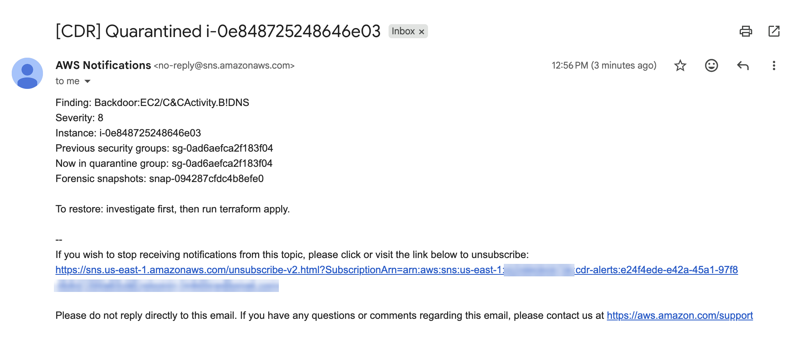
*A real (non-sample) `Backdoor:EC2/C&CActivity.B!DNS` finding, raised by
GuardDuty and contained by Lambda with no human involved: security groups
swapped for a no-traffic quarantine group, IAM role removed, disk
snapshotted for forensics, and this email sent.*

---

## Before and after

This project rebuilds the architecture of an earlier, console-built
[Cloud Security Hardening](https://github.com/DevinCodes13/Cloud-Security-Hardening-AWS)
project as code, then adds detection and response on top of it.

| | Hardening project (before) | This project (after) |
|---|---|---|
| Provisioning | AWS console, by hand | Terraform, rebuildable from an empty account |
| Detection | Logs collected, nobody watching them | GuardDuty analysing CloudTrail, Flow Logs and DNS |
| Response | None | Three Lambda responders, triggered automatically |
| Admin access to servers | SSH, port 22 open to one IP | Session Manager — **zero** inbound ports |
| Private tier egress | Anything inside the VPC | HTTPS to two AWS service paths only |
| IAM for automation | N/A | Every role capped by a permissions boundary |
| Quarantine | N/A | Network **and** credential isolation |

---

## Table of contents

- [Architecture](#architecture)
- [Tech stack](#tech-stack)
- [Phase 1: The baseline — network, cameras, and a guard](#phase-1-the-baseline--network-cameras-and-a-guard)
- [Phase 2: Automated response](#phase-2-automated-response)
- [Phase 3: Zero Trust](#phase-3-zero-trust)
- [Threat model](#threat-model)
- [Security decisions and trade-offs](#security-decisions-and-trade-offs)
- [Results and metrics](#results-and-metrics)
- [How to deploy](#how-to-deploy)
- [Repository layout](#repository-layout)
- [Troubleshooting log & lessons learned](#troubleshooting-log--lessons-learned)
- [Roadmap](#roadmap)

---

## Architecture

```
                         ┌──────────────── detection ────────────────┐
  CloudTrail (all regions) ─┐
  VPC Flow Logs ────────────┼──> GuardDuty ──> EventBridge rules ──┬──> cdr-isolate-ec2   ──> quarantine SG + strip IAM role + snapshot
  DNS query logs ───────────┘                                      ├──> cdr-disable-keys  ──> access key set to Inactive
                                                                   └──> cdr-lock-s3       ──> Block Public Access back on
                                                                              │
                                                                              └──> SNS ──> email report

  VPC 10.0.0.0/16 (us-east-1a)
  ├── public subnet  10.0.1.0/24 ── cdr-public-web   (no inbound; HTTPS out)
  └── private subnet 10.0.2.0/24 ── cdr-private-app  (no inbound; no internet route)
                                     └── VPC endpoints: ssm, ssmmessages, ec2messages (interface)
                                                        s3 (gateway, free)
```

See [`docs/diagrams/cdr-architecture.md`](docs/diagrams/cdr-architecture.md)
for the full diagram (renders automatically on GitHub).

**Three ideas run through the whole design:**

1. **Detect from the logs you already have.** GuardDuty needs no agents —
   it reads CloudTrail, Flow Logs and DNS logs that the account produces
   anyway.
2. **Respond narrowly.** Every responder acts only on resources belonging
   to this project, enforced twice: once in the Python code and again in
   its IAM policy, so a bug in the code still cannot touch anything else.
3. **No standing access.** No SSH keys, no open ports. Getting onto a
   server means asking AWS, which checks IAM and MFA first.

---

## Tech stack

| Layer | Technology |
|---|---|
| Infrastructure as code | Terraform 1.10+, AWS provider 6.x, S3 backend with native locking |
| Detection | Amazon GuardDuty |
| Telemetry | AWS CloudTrail (multi-region, log file validation), VPC Flow Logs |
| Event routing | Amazon EventBridge |
| Response | AWS Lambda (Python 3.12, boto3) |
| Alerting | Amazon SNS (email) |
| Compute | EC2 t3.micro, Amazon Linux 2023, IMDSv2 required, encrypted gp3 |
| Admin access | AWS Systems Manager Session Manager over VPC interface endpoints |
| Identity | IAM roles with permissions boundaries, tag- and name-scoped policies |
| Dev environment | Vagrant-provisioned Fedora box (FIPS crypto policy) |

---

## Phase 1: The baseline — network, cameras, and a guard

**Goal:** rebuild the hardening project's environment as code, and turn on
something that actually *watches* the logs.

### Terraform state, reused

A state bucket created for this project in September
(`aws-detection-response-tfstate-…`) turned out to be empty — the project had
been started and paused before any code existed. Rather than create another,
it was reused with versioning switched on and state stored under a `cdr/`
key. Terraform runs as a dedicated IAM user whose project permissions live
in their own `CDR-Terraform` group (see the troubleshooting log for why).

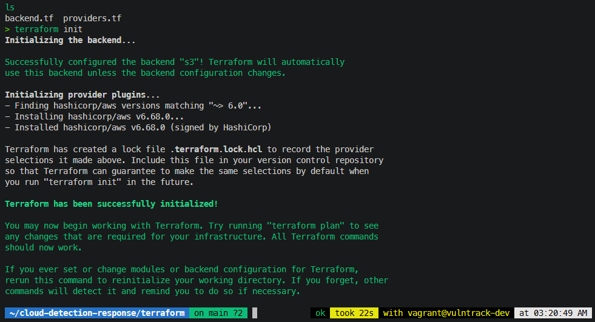

### The network

A VPC with a public and a private subnet in one availability zone. The
private subnet's route table has **no route out at all** — no NAT gateway,
no internet. The VPC's built-in *default* security group, which normally
lets everything inside the VPC talk freely, is emptied by Terraform so
nothing can accidentally use it.

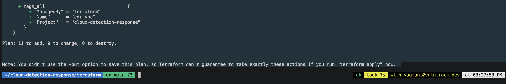

### The cameras and the guard

| Component | What it records, plainly |
|---|---|
| **CloudTrail** | Every action anyone takes in the account, in every region |
| **VPC Flow Logs** | Every network connection in the VPC, accepted or rejected |
| **GuardDuty** | Reads both, plus DNS queries, and raises findings on bad behaviour |

Both log sources write to one central bucket that is locked down hard:
public access blocked, bucket-owner-enforced ownership, versioning on (so a
deleted log is still recoverable — attackers delete logs), encrypted at
rest, HTTPS-only, a 90-day lifecycle, and a bucket policy that lets
CloudTrail and Flow Logs write *only* into their own prefixes. CloudTrail's
log file validation writes signed digest files so tampering is provable.

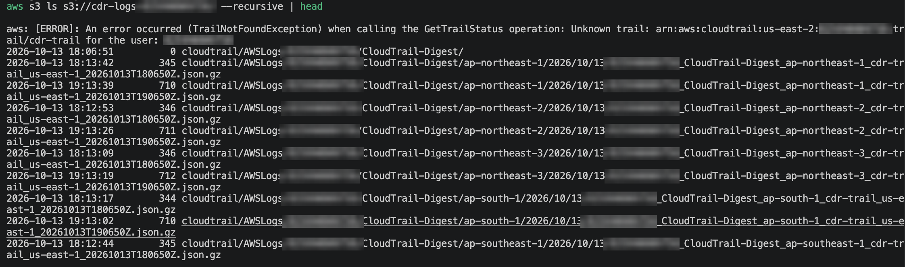
*Digest files arriving from every AWS region — the multi-region trail and
log file validation both working.*

GuardDuty publishes finding updates every 15 minutes instead of the default
6 hours, because Phase 2's responders listen for those events.

### The servers

`cdr-public-web` in the public subnet, `cdr-private-app` in the private one.
Both require **IMDSv2** — the instance metadata service only hands out the
server's credentials to callers holding a session token, which defeats the
classic SSRF-to-credential-theft attack — and both have encrypted disks.

Network segmentation was proven, not assumed:

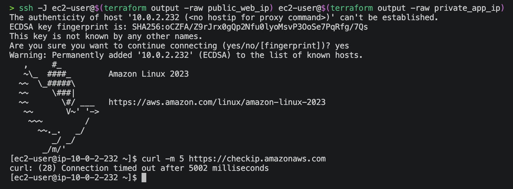
*From the private tier, `curl https://checkip.amazonaws.com` times out.
There is no road out.*

---

## Phase 2: Automated response

**Goal:** close the gap between "GuardDuty noticed" and "something was done
about it" — automatically, safely, and with a paper trail.

### The pattern

```
GuardDuty finding ──> EventBridge rule (filters by type/severity) ──> Lambda responder ──> SNS email
```

| Responder | Triggered by | Action |
|---|---|---|
| `cdr-isolate-ec2` | EC2 findings, severity ≥ 4 | Swap all security groups for a no-traffic quarantine group, remove the IAM role (Phase 3), snapshot every volume, tag the instance with what changed |
| `cdr-disable-keys` | IAM access-key findings, severity ≥ 4 (S3 policy findings excluded) | Set the access key to `Inactive` — reversible, nothing deleted |
| `cdr-lock-s3` | Any `Policy:S3/*` finding, regardless of severity | Turn all four S3 Block Public Access settings back on |

### Guardrails before any action

Every responder checks, in order:

1. **Is this a GuardDuty sample finding?** Then email only, touch nothing.
2. **Is the target part of this project?** Instances must carry
   `Project=cloud-detection-response`; IAM users and buckets must be named
   `cdr-*`. Anything else gets an "out of scope, manual review" email.
3. **Is it already handled?** An instance already tagged
   `cdr-status=quarantined` is left alone.

Guardrail 2 is enforced **twice**. The key responder's Python checks the
`cdr-` prefix, *and* its IAM policy only allows `iam:UpdateAccessKey` on
`user/cdr-*`. A bug in the code still cannot disable the administrator's or
Terraform's keys — which, given that the hardening project's three incidents
were all self-lockouts, mattered.

### Every responder wears a ceiling

The Terraform user can create IAM roles, which is normally a privilege
escalation path: create a role with `AdministratorAccess`, hand it to a
Lambda, done. Here, `iam:CreateRole` only succeeds if the new role carries
the `CDR-Lambda-Boundary` **permissions boundary** — a hard cap listing the
only actions a responder could ever have, whatever its own policy says.
The user has no permission to remove a boundary, and can only pass these
roles to Lambda.

### Test 1 — Sample findings through the whole pipe

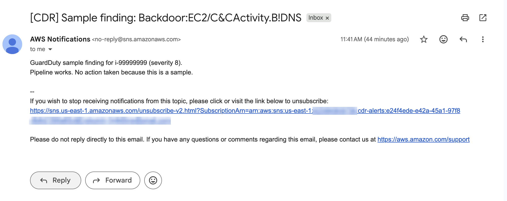
*A GuardDuty sample finding travelling GuardDuty → EventBridge → Lambda →
SNS. The responder recognised it as a drill and touched nothing.*

### Test 2 — A real finding, contained live

AWS publishes a harmless test domain, `guarddutyc2activityb.com`. When an
instance resolves it through the VPC's DNS, GuardDuty raises a genuine
`Backdoor:EC2/C&CActivity.B!DNS` finding — what a server phoning a
command-and-control server looks like.

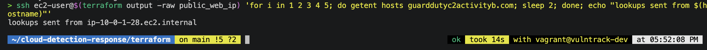

Minutes later, with nobody touching anything:

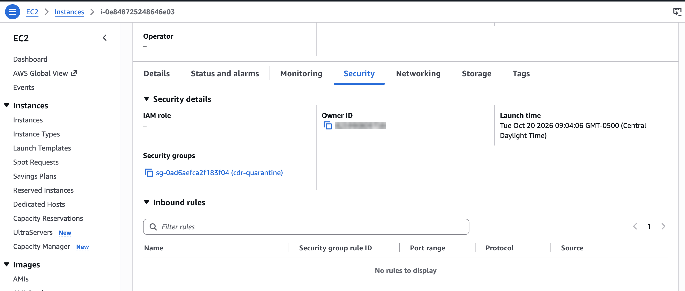
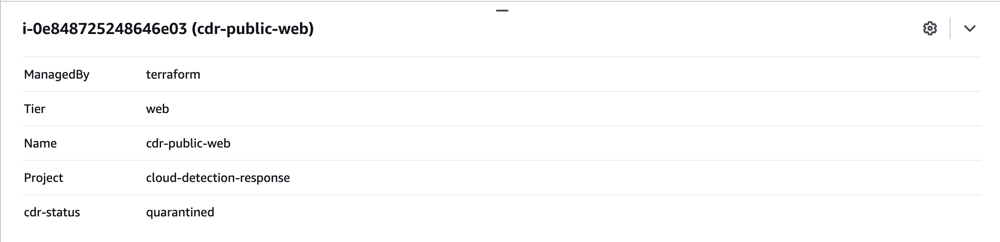
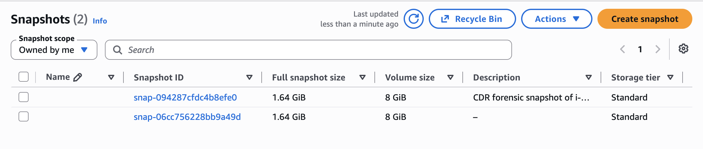
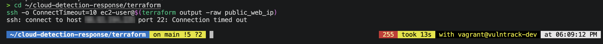

### Restoring is one command

The responder changes the instance *outside* Terraform, so Terraform sees
the drift and offers to put the healthy configuration back:

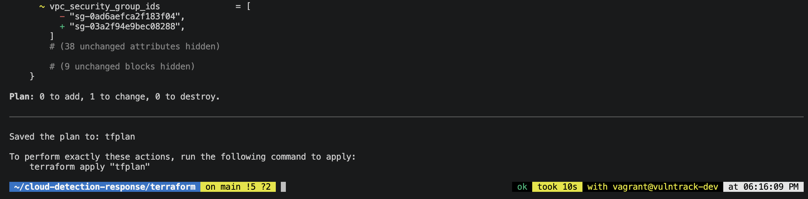

That restore first **failed** — see *"The responder could lock the door,
but nothing could unlock it"* in the troubleshooting log. Testing the
recovery path, not just the response, is the lesson of this phase.

### Test 3 — A real public-bucket event

Block Public Access was really switched off on an empty test bucket
(`cdr-test-public-…`). CloudTrail recorded it, GuardDuty raised
`Policy:S3/BucketBlockPublicAccessDisabled`, and the responder switched it
back on.

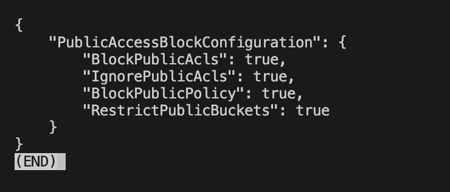

This test also surfaced the phase's best bug: the first attempt never
reached the responder at all, because GuardDuty files this finding under
the *access key that made the change*, not the bucket. Found by reading the
raw finding rather than trusting the documentation in my head — see the log.

### Test 4 — The key responder

Triggering a real credential-exfiltration finding would require genuinely
leaking credentials, so this responder was tested with a
**production-shaped simulated event** invoked directly — stated plainly
rather than dressed up as live.

| Test | Target | Expected | Result |
|---|---|---|---|
| Sample finding via EventBridge | — | Email, no action | ✅ |
| Simulated finding | `devin-developer` (real user) | `out of scope`, no action | ✅ |
| Simulated finding | `cdr-test-user` (throwaway) | Key set to `Inactive` | ✅ |

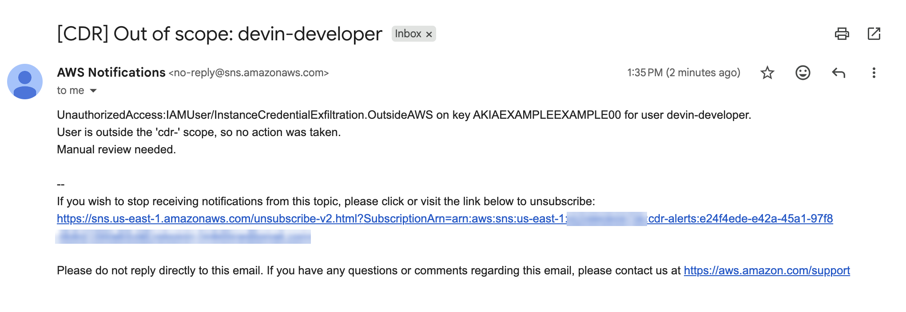
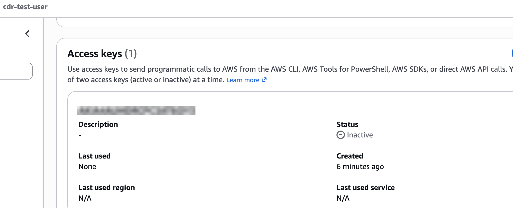

The throwaway user was deleted after testing.

---

## Phase 3: Zero Trust

**Goal:** remove standing access. Nobody — including me — gets onto a
server, or into the account, without proving who they are every time.

### 3.1 — The root account goes in the safe

GuardDuty caught **root credential usage** mid-project
(`Policy:IAMUser/RootCredentialUsage`). It was me, doing console work as
root. Root was used one final time as a deliberate break-glass action to
reset the IAM administrator's credentials; everything since has been done
as an MFA-protected IAM admin.

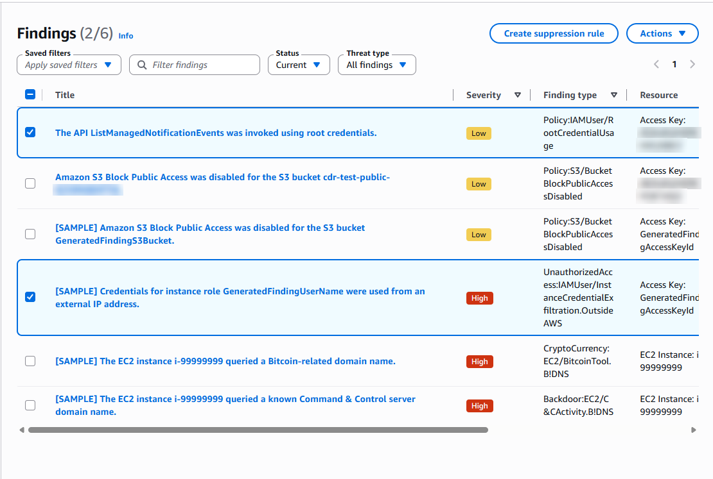

That switch exposed a bug that had been misdiagnosed since the hardening
project — see *"AdminWithMFA never checked for MFA"* in the troubleshooting
log. The fix replaced it with a policy that denies everything without MFA,
and denies **everyone** — admins included — the ability to stop CloudTrail
or delete GuardDuty.

| Before | After |
|---|---|
| 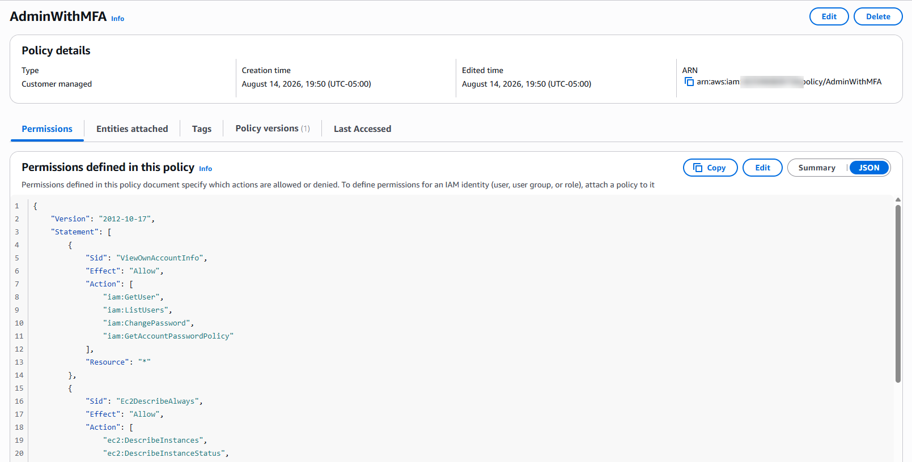 | 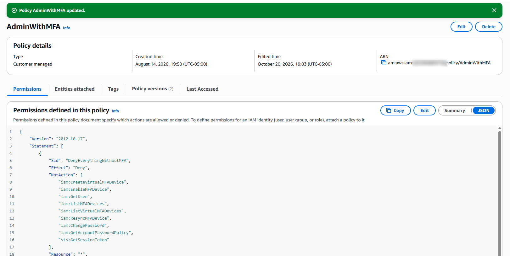 |

### 3.2 — Session Manager instead of SSH

SSH needs an open port and a key that can be stolen. Session Manager
inverts the direction: an agent on each server makes an **outbound**
connection to AWS, and an administrator connects by asking AWS, which
checks IAM and MFA first. No inbound port exists to attack.

The private server has no internet, so it reaches Session Manager through
three VPC **interface endpoints** — private doors into AWS services that
never leave the VPC — plus a free **gateway endpoint** for S3, so it can
still receive OS updates.

The servers' IAM role can *only* talk to Session Manager, and it carries
its own boundary (`CDR-EC2-Boundary`). The Terraform user can pass server
roles only to EC2 and responder roles only to Lambda: a server can never
be given a responder's powers.

It was rolled out in two stages, deliberately: **add Session Manager,
prove it works, and only then remove SSH** — so a failure could never
lock me out.

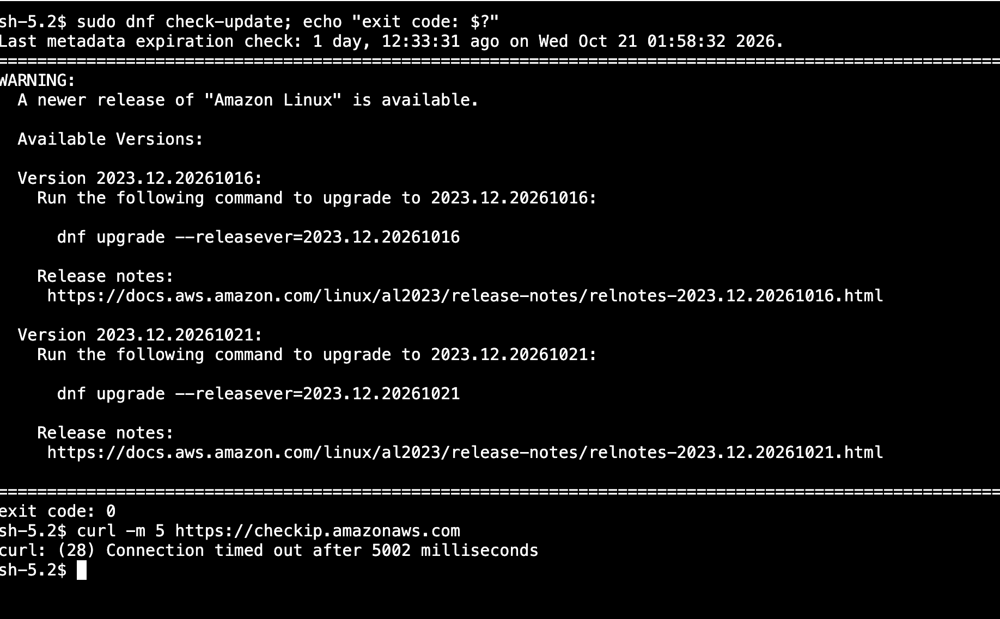
*A Session Manager shell (`sh-5.2$`) on the private server — no public IP, no
internet route, no SSH — still receiving OS updates through the free S3
gateway endpoint.*

### 3.3 — Micro-segmentation

| Server | Inbound | Outbound |
|---|---|---|
| `cdr-public-web` | **none** | TCP 443 only |
| `cdr-private-app` | **none** | TCP 443 to the SSM endpoints' security group, and TCP 443 to the S3 prefix list |

The plan: both SSH rules coming out, and the security groups replaced in
the safe *create-then-destroy* order (`+/-`):

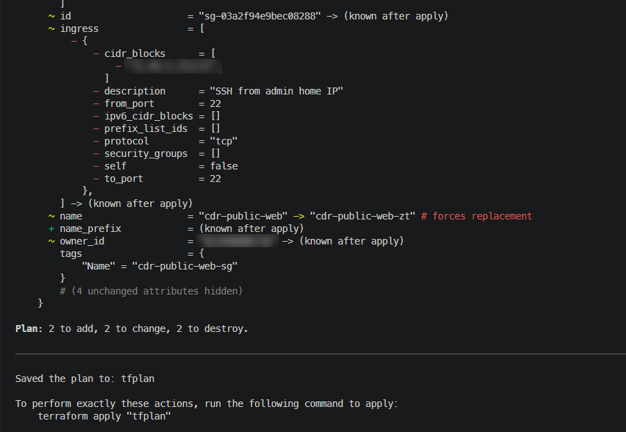
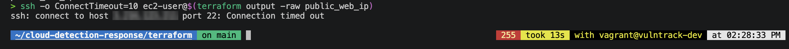

### 3.4 — Quarantine takes the badge, not just the door

Swapping security groups stops **new** connections, but tracked
connections can survive the change — and a quarantined server was still
wearing its IAM role. The isolation responder now also **disassociates the
instance profile**, so anything running on the box loses its AWS
credentials and long-lived connections cannot refresh. The previous profile
is recorded in a tag, and `terraform apply` restores both.

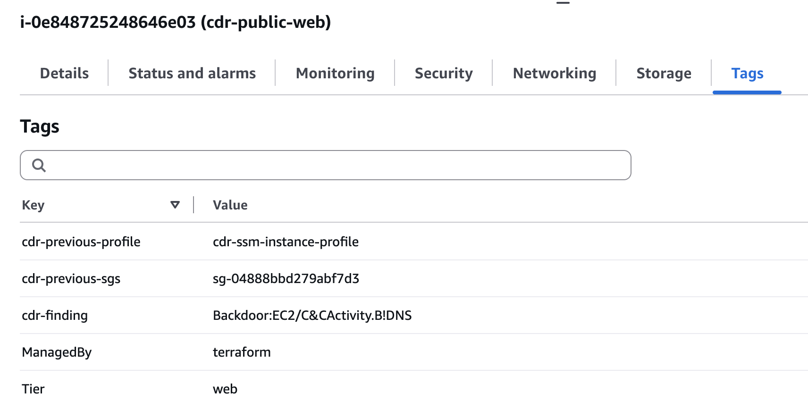
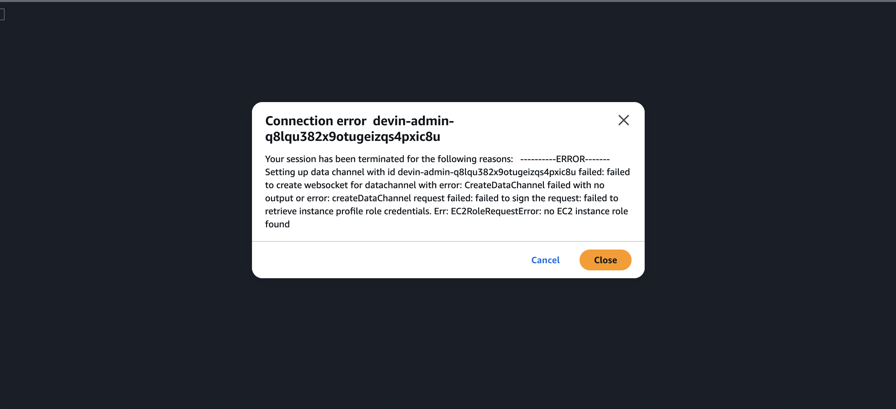
*The proof the credentials are really gone: Session Manager itself now
fails with `EC2RoleRequestError: no EC2 instance role found`.*
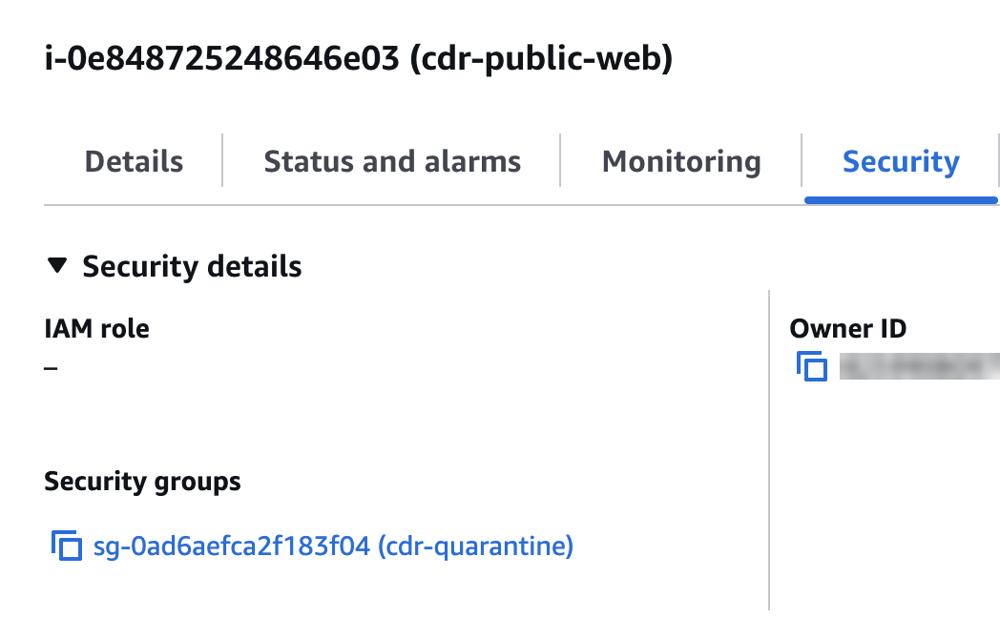

A deliberate side effect: quarantine cuts off Session Manager too.
Investigation happens on the forensic snapshot, never on the live,
possibly-compromised box.

---

## Threat model

**Assets:** the EC2 workloads; IAM credentials (user keys and instance
roles); data in S3; the telemetry itself (CloudTrail, Flow Logs, GuardDuty);
and the responders, which hold real permissions.

| # | Threat | Vector | Prevent | Detect | Respond |
|---|---|---|---|---|---|
| T1 | Compromised server phones home | Malware → C2 over DNS/HTTP | No inbound ports; private tier has no internet; HTTPS-only egress | GuardDuty `Backdoor:EC2/*`, `CryptoCurrency:EC2/*` | Quarantine SG, strip IAM role, snapshot, email |
| T2 | Instance credentials stolen | SSRF against the metadata service | IMDSv2 required; role limited to Session Manager by a boundary | GuardDuty `InstanceCredentialExfiltration` | Isolation removes the role |
| T3 | Access key leaked | Key committed or phished | No long-lived keys on servers | GuardDuty `UnauthorizedAccess:IAMUser/*` | Key set to `Inactive` (in-scope users) |
| T4 | Bucket made public | Misconfiguration or attacker | Block Public Access on all buckets | GuardDuty `Policy:S3/BucketBlockPublicAccessDisabled` | Block Public Access re-enabled |
| T5 | Logs destroyed to hide activity | Stop the trail, delete the detector, delete logs | Explicit deny on `StopLogging`/`DeleteTrail`/`DeleteDetector` for admins; bucket versioning; log file validation | CloudTrail records the attempt | Manual |
| T6 | Privilege escalation through automation | Create an admin role, attach it to a Lambda | Permissions boundaries on every created role; `PassRole` split by service; everything name-scoped to `cdr-*` | CloudTrail | Manual |
| T7 | Responder harms the wrong resource | Bug, or a finding on a non-project resource | Tag/prefix scope enforced in code **and** IAM | Out-of-scope email | Manual review |
| T8 | Brute force against SSH | Internet scanning (observed in the hardening project) | Port 22 removed entirely | — | — |
| T9 | Root account misuse | Stolen root credentials | MFA; root reserved for break-glass | GuardDuty `RootCredentialUsage` | Manual |

### Accepted risks

| Risk | Why it is accepted |
|---|---|
| GuardDuty latency | EC2 DNS findings arrived in minutes; S3 policy findings took 15–30. Containment is "minutes," not "seconds." Acceptable for a lab; a real environment would add a faster CloudTrail-pattern rule for the highest-value events. |
| Key responder only acts on `cdr-*` users | Auto-disabling a real administrator's key could take production down. Out-of-scope keys produce an email for a human decision instead. |
| Single availability zone | Lab cost. Not a high-availability design. |
| Protections apply to the IAM admin, not root | Root cannot be restricted by IAM policy in a standalone account. An Organizations SCP would close this. |
| IAM boundary policies created in the console | They are the guardrails *on* Terraform, so they are managed outside Terraform's own permissions. Their JSON is preserved in [`docs/iam/`](docs/iam/). |

---

## Security decisions and trade-offs

- **Quarantine by security group, not by stopping the instance.** Stopping
  loses memory, the most valuable forensic evidence. Isolating keeps the
  box running and inspectable; the snapshot preserves the disk.
- **Disable keys, don't delete them.** `Inactive` is reversible in one
  click if the finding is a false positive. Deletion is not.
- **Route S3 findings by type, not severity.** GuardDuty rates "Block
  Public Access disabled" LOW. For a security team it is urgent.
  Detection tuned to *this* environment's risk, not the vendor's default.
- **A dedicated IAM group instead of more policies on the user.** IAM
  users can hold 10 managed policies; this one was full from VulnTrack.
  Project permissions in their own group also come off cleanly when the
  project is torn down.
- **Name and tag scoping everywhere.** The Terraform user can only stop,
  modify or terminate instances tagged `Project=cloud-detection-response`,
  can only add tags at creation time, and can remove any tag *except*
  `Project` — so it cannot re-tag someone else's server into scope or
  strip a tag to escape the fence.
- **RSA-4096 for the (now removed) SSH key.** The dev box's FIPS policy
  refuses ed25519; EC2 refuses ECDSA. RSA-4096 satisfies both.
- **Interface endpoints behind a toggle.** Three endpoints cost about
  $0.72/day; `enable_ssm_endpoints=false` turns them off between sessions.

---

## Results and metrics

| Measure | Before | After |
|---|---|---|
| Inbound ports open to the internet | 1 (22/tcp, one IP) | **0** |
| Long-lived credentials needed to reach a server | SSH private key | **None** (IAM + MFA) |
| Private tier egress | All protocols to the whole VPC | **443 only, to two AWS service paths** |
| Human steps between finding and containment | All of them | **0** |
| Quarantine scope | — | Network **and** IAM credentials |
| Automated responders | 0 | **3**, all tested |
| Roles able to exceed their boundary | — | **0** — enforced at `CreateRole` |
| Admin able to stop the trail or delete GuardDuty | Yes | **No** |
| Detection → containment, real EC2 finding | — | **TODO: ~N minutes** |

<!-- TODO: fill the last row. Compare the real finding's first-seen time:
       aws guardduty get-findings ... --query 'Findings[].Service.EventFirstSeen'
     with the responder's log line:
       aws logs filter-log-events --log-group-name /aws/lambda/cdr-isolate-ec2 --filter-pattern quarantined
-->

---

## How to deploy

### Prerequisites

- An AWS account with GuardDuty not yet enabled (or enabled in `us-east-1`)
- Terraform ≥ 1.10, AWS CLI v2
- An S3 bucket for Terraform state
- The IAM policies in [`docs/iam/`](docs/iam/), created by an administrator:
  `CDR-Lambda-Boundary` and `CDR-EC2-Boundary` (unattached), and the
  `CDR-Terraform-*` policies attached to a group containing the Terraform
  user. Replace `<ACCOUNT_ID>` and `<CDR_VPC_ID>` first. (The VPC ID only
  exists after the first apply; the network-interface statement can be
  added then.)

### Deploy

```bash
cd terraform
cat > terraform.tfvars <<'EOF'
admin_ip    = "203.0.113.10/32"   # unused once SSH is removed; still required by variables.tf
alert_email = "you@example.com"
EOF

terraform init
terraform plan -out=tfplan
terraform apply tfplan
```

Then confirm the **"AWS Notification - Subscription Confirmation"** email —
until you do, every alert is silently dropped.

### Test it safely

```bash
D=$(aws guardduty list-detectors --region us-east-1 --query 'DetectorIds[0]' --output text)
aws guardduty create-sample-findings --detector-id "$D" --region us-east-1 \
  --finding-types 'Backdoor:EC2/C&CActivity.B!DNS'
```

### Between sessions

```bash
terraform apply -var enable_ssm_endpoints=false
aws ec2 stop-instances --region us-east-1 --instance-ids \
  $(terraform output -raw public_web_id) $(terraform output -raw private_app_id)
```

### Tear down

```bash
terraform destroy
```

Forensic snapshots are created by the responder, not Terraform, so delete
them separately (EC2 → Snapshots, tag `cdr-evidence-for`). GuardDuty
starts billing after its 30-day trial.

---

## Repository layout

```
terraform/
  backend.tf          S3 backend, provider versions
  providers.tf        AWS provider, default tags
  variables.tf
  network.tf          VPC, subnets, routing, locked default SG
  security_groups.tf  Zero Trust security groups
  logging.tf          Central log bucket, CloudTrail, VPC Flow Logs
  guardduty.tf        Detector
  compute.tf          Both EC2 instances
  response.tf         Quarantine SG, SNS, isolation responder
  response_iam_s3.tf  Key and S3 responders, test bucket
  zero_trust.tf       Instance role, VPC endpoints
  outputs.tf
lambda/
  isolate_ec2.py
  disable_keys.py
  lock_s3.py
docs/
  diagrams/           Architecture diagram (Mermaid)
  iam/                Console-managed IAM policies, as JSON
  screenshots/
```

---

## Troubleshooting log & lessons learned

Kept here rather than smoothed over, since debugging real infrastructure
issues is a meaningful part of what this project demonstrates.

### Phase 1

- **The project's own state bucket was unreachable.** The Terraform user
  had been scoped to VulnTrack's bucket only. Fixed with a policy granting
  `ListBucket` on this bucket and object read/write on its `cdr/` prefix
  only — not the bucket's settings, and not VulnTrack's state.
- **IAM users can hold at most 10 managed policies.** The Terraform user
  was already full. Project permissions moved into a dedicated
  `CDR-Terraform` group, which also makes them easy to remove later.

  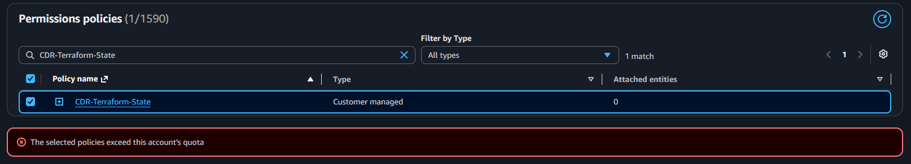
- **The wrong identity, twice.** The default CLI profile is a deliberately
  weak developer user; `AWS_PROFILE` resets on every login, so Terraform
  kept arriving as that user and being denied — least privilege doing its
  job. Persisted in the shell profile.
- **`SignatureDoesNotMatch: Signature expired`.** The Vagrant VM's clock
  was ten hours behind after the host slept, and AWS rejects requests
  stamped more than 15 minutes off. Fixed with `chronyc -a makestep`, now
  the first command of every session.
- **`TrailNotFoundException` for a trail that existed.** The CLI defaulted
  to `us-east-2`; everything was built in `us-east-1`.
- **No key type satisfied both sides.** The dev box's FIPS crypto policy
  refused to use an ed25519 key; switching to ECDSA, EC2's `ImportKeyPair`
  rejected it outright (EC2 accepts only RSA and ed25519). RSA-4096 is
  the overlap.
- **`most_recent = true` would have rebuilt both servers.** A newer Amazon
  Linux AMI was published mid-project and the plan wanted to replace the
  instances. `lifecycle { ignore_changes = [ami] }` stops an image release
  from becoming an outage.
- **GitHub stopped accepting passwords for Git.** Switched the remote to
  SSH with a dedicated key.

### Phase 2

- **The first alert vanished.** The SNS email subscription had never left
  `PendingConfirmation`, so SNS accepted the message and dropped it. The
  responder had worked; the inbox was never subscribed.
  `list-subscriptions-by-topic` made it visible.
- **The responder could lock the door, but nothing could unlock it.**
  After a real quarantine, `terraform apply` failed: putting the original
  security group back needs `ec2:ModifyNetworkInterfaceAttribute`, and
  removing the quarantine tags needs `ec2:DeleteTags` — neither of which
  the Terraform user had. Added, scoped to this VPC and to project-tagged
  security groups, with tag removal allowed for every tag *except*
  `Project`. **Test the recovery path, not just the response.**

  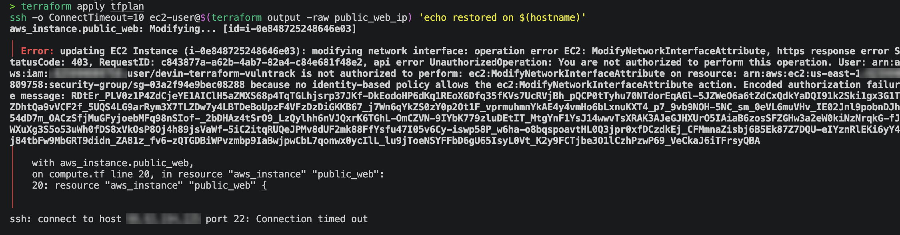
- **The S3 responder never heard its own alarm.** The EventBridge rule
  matched `resourceType = S3Bucket`. Pulling the raw finding showed
  GuardDuty labels `Policy:S3/BucketBlockPublicAccessDisabled` with
  `ResourceType: AccessKey` — the identity that made the change. Fixed by
  matching on the finding type alone, and excluding `Policy:S3/*` from the
  access-key rule so an S3 finding can never disable a key.
- **Typographic quotes broke a shell command.** A macOS app converted `'`
  to `’`, leaving zsh waiting at a `quote>` prompt. Smart quotes are now
  off.

### Phase 3

- **GuardDuty caught me.** Console work done as root raised
  `Policy:IAMUser/RootCredentialUsage` — the detector working exactly as
  intended. Root is now break-glass only.
- **AdminWithMFA never checked for MFA.** With MFA set up and a fresh,
  MFA-verified sign-in, `iam:CreatePolicy` was still explicitly denied.
  Reading the policy showed why: its deny statement had **no condition at
  all**, and the rest of it was a developer template (a tag rule for
  `Owner=developer` and an unfilled bucket placeholder). This **corrects
  the hardening project's record**: its two "MFA session" incidents were
  really this unconditional deny on `cloudtrail:UpdateTrail` and
  `ec2:AuthorizeSecurityGroupIngress`. VulnTrack had already tripped over
  the same deny without the root cause being traced. Replaced with a real
  MFA-gated policy.

  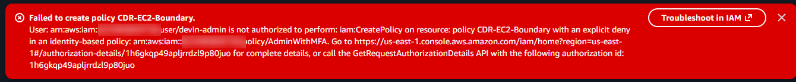
- **A stale IP connected to a stranger.** After a stop/start, Terraform's
  outputs still held the old public IP; it had already been reassigned,
  and another customer's host refused the connection. Refresh state before
  trusting an output.
- **The private server never checked in.** Its SSM agent had tried to
  register before the VPC endpoints existed, then backed off. Verified the
  endpoint path from inside the box (private DNS resolving to `10.0.2.x`,
  HTTPS reachable), then restarted the agent.
- **The S3 hallway was built but the door was shut.** The private tier's
  egress allowed only the VPC CIDR, and S3's gateway endpoint uses public
  S3 addresses. Fixed by allowing 443 to the S3 managed **prefix list**
  rather than opening egress broadly.
- **Security group descriptions are immutable.** Changing one forces
  replacement, and Terraform's default destroy-then-create order fails on
  a group still attached to a running instance. Fixed with new names and
  `create_before_destroy`, so the new groups are attached before the old
  ones are removed.

---

## Roadmap

- [x] Phase 1 — Terraform baseline: segmented VPC, central hardened log bucket, multi-region CloudTrail with validation, VPC Flow Logs, GuardDuty, two IMDSv2 instances
- [x] Phase 2 — Automated response: three GuardDuty-driven Lambda responders with sample-finding and scope guardrails, permissions boundaries on every responder role, tested with real EC2 and S3 findings and a recovery path that actually works
- [x] Phase 3 — Zero Trust: root retired to break-glass, MFA-enforcing admin policy that protects the telemetry, Session Manager over VPC endpoints, SSH removed, least-privilege egress, quarantine that strips IAM credentials
- [ ] Organizations SCP denying `StopLogging`/`DeleteDetector` — extends the camera protection to root
- [ ] Faster path for the highest-value events — an EventBridge rule on the CloudTrail API call itself (e.g. `DeletePublicAccessBlock`) instead of waiting 15–30 minutes for the GuardDuty finding
- [ ] Session Manager session logging to S3, so every admin keystroke is recorded
- [ ] Unit tests for the responders using recorded finding JSON
- [ ] Bring the console-managed IAM policies under a separate, admin-run Terraform root
- [ ] Next project — Compliance as Code on this environment: AWS Config rules, OPA policy checks in CI, automated evidence collection, Grafana

---

## Author

Devin Phillips — [github.com/DevinCodes13](https://github.com/DevinCodes13)
