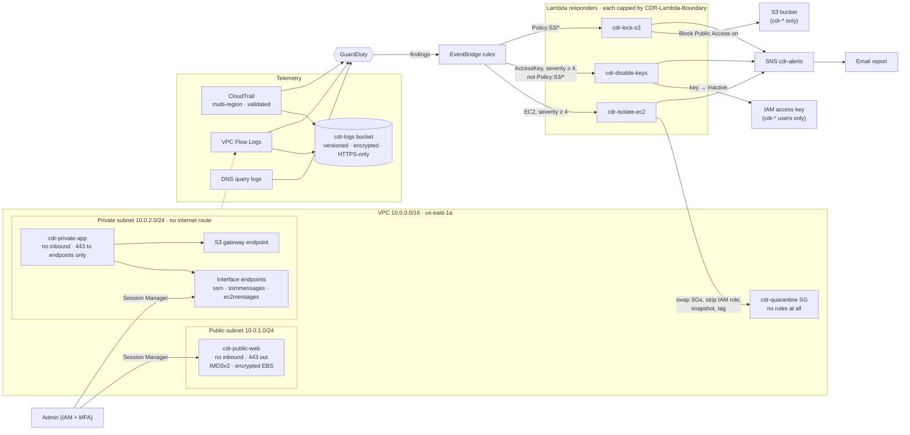

# Cloud Detection & Response — architecture

How a threat moves from "something happened" to "it's contained," and where
each piece lives.

## Notes

- **Everything the responders touch is scoped twice** — once in the Python
  (`Project` tag or `cdr-` prefix) and once in the role's IAM policy.
- **The quarantine security group has no rules**, so a quarantined instance
  can send and receive nothing new. Removing the instance profile at the
  same time takes away its AWS credentials.
- **Session Manager connections are outbound from the instance.** No arrow
  points *into* either server from the internet.
- The interface endpoints cost money while they exist and are toggled with
  `enable_ssm_endpoints`; the S3 gateway endpoint is free and always on.
